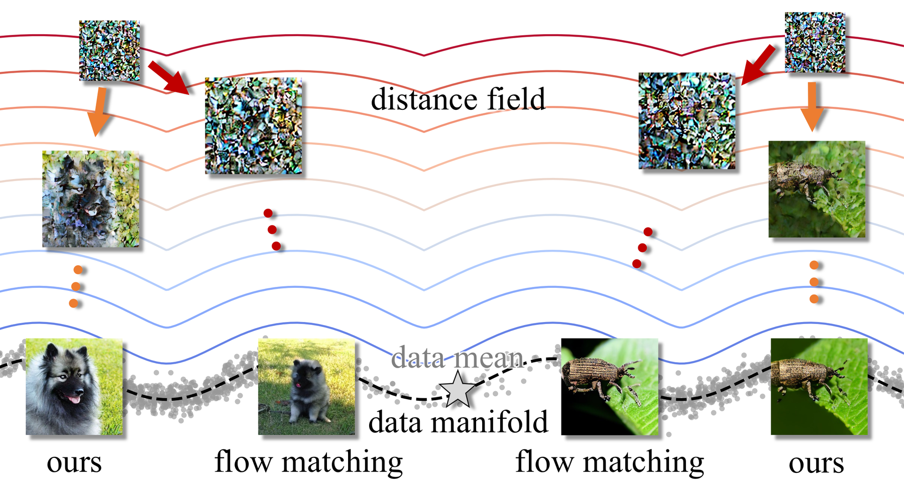
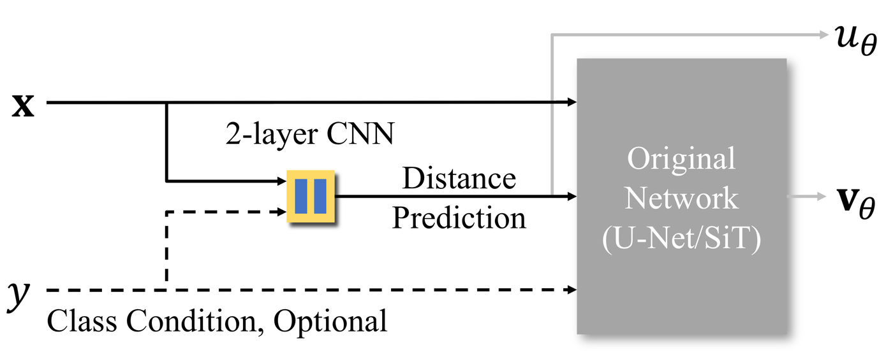
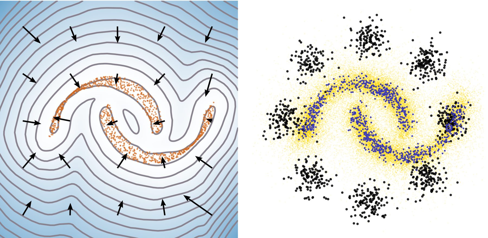
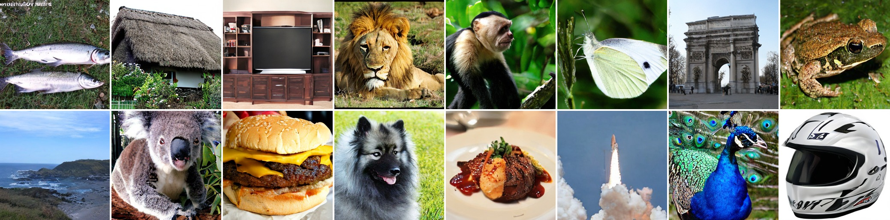
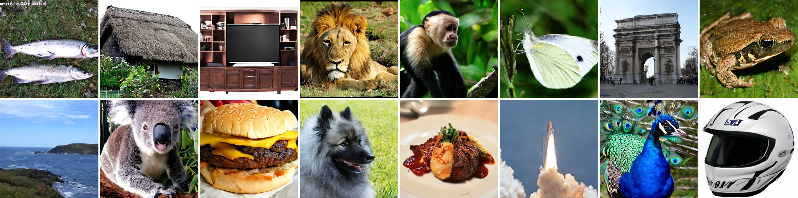
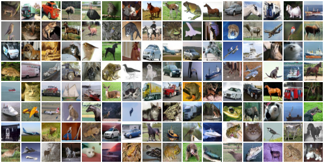

# Distance Marching for Generative Modeling

<sub>Official PyTorch implementation</sub>

### [Paper](https://arxiv.org/abs/2602.02928) | [Project page](https://zeamoxwang.github.io/distance-marching-website/) | [Pretrained checkpoints](https://huggingface.co/zimowang/Distance-Marching)

Zimo Wang, Ishit Mehta, Haolin Lu, Xunpeng Huang, Chung-En Sun, Ge Yan, Tsui-Wei Weng, Tzu-Mao Li
<br>UC San Diego

<p align="center">
  
</p>

Diffusion and flow-matching models transport noise toward the data manifold
without representing the manifold itself. **Distance Marching** explores the
alternative: it explicitly learns a *distance field* of the data manifold, so
that generation becomes a descent process that only needs the current position.
The negative gradient of the field gives the direction, the distance value can
optionally determine the step size, and no time input is needed. As shown above,
our losses emphasize closer targets, whereas the flow-matching loss favors a
direction biased toward the data mean in the early stages of generation; after
20% of the sampling steps our trajectories wander less.

This repository contains:

* Two self-contained codebases: [`cifar10/`](cifar10/) (pixel space, UNet) and
  [`imagenet/`](imagenet/) (latent space of SD-VAE, SiT backbone), each with
  training, sampling and FID evaluation.
* Pretrained checkpoints for CIFAR-10 and ImageNet 256x256 (SiT-B/2) on
  [Hugging Face](https://huggingface.co/zimowang/Distance-Marching), downloaded
  automatically by the sampling scripts.
* The launch scripts and Kubernetes manifests used for the paper runs in
  [`execute/`](execute/).

## Method

<p align="center">
  
</p>

The network takes only the (noisy) image `x` and an optional class label `y`. A
light 2-layer CNN head predicts the distance `u_theta(x)` to the data manifold,
and the backbone (the original U-Net or SiT) receives this prediction through
the slot that normally takes the time embedding and outputs the denoising
direction `v_theta(x)`.

For each training pair `(x, s)`, `x` is the standard linear interpolation between
Gaussian noise and a data sample `s`, drawn without reassignment. Two losses are
used:

* **One-Step Loss** `w * || x - u_theta(x) v_theta(x) - s ||^2` with the
  weight `w = 1 / (||x - s||^2 + eps)`, which emphasizes closer targets and
  mitigates the bias toward the data mean.
* **Directional Eikonal Loss** `|| v_theta(x) - (x - s) / sqrt(||x - s||^2 + c_0) ||^2`,
  which fixes the offset of the learned field.

The learned field directly gives two deterministic samplers. Both start from
pure Gaussian noise and run a fixed number of steps with step size `eta`:

| Sampler | Update | Step size (paper) |
| --- | --- | --- |
| Sphere tracing (`st`) | `x <- x - eta * u_theta(x) * v_theta(x)` | 0.031 (CIFAR-10), 0.022 (ImageNet) |
| Gradient descent (`gd`) | `x <- x - eta * v_theta(x)` | 0.46 (CIFAR-10), 0.64 (ImageNet B/2) |

<p align="center">
  
</p>

*Left:* target two moons (orange) and the learned distance-like scalar field
`u_theta` with `-grad u_theta`. *Right:* our samples: initial (black),
intermediate (yellow) and final (blue).

## Samples

Curated ImageNet 256x256 samples from our XL/2 model with CFG scale 4.0. Top:
250-step sphere tracing with step size 0.015; bottom: 250-step gradient descent
with step size 0.5.

<p align="center">
  
  
</p>

CIFAR-10, unconditional (no class and no time input), uncurated:

<p align="center">
  
</p>

## Setup

Each folder has its own `requirements.txt` (PyTorch 2.x, torchvision,
torchmetrics for CIFAR-10 FID; diffusers, timm and TensorFlow for the ImageNet
VAE and the ADM evaluator):

```bash
git clone git@github.com:ZeamoxWang/distance-marching.git
cd distance-marching
pip install -r cifar10/requirements.txt    # pixel-space CIFAR-10 code
pip install -r imagenet/requirements.txt   # latent-space ImageNet code
```

CIFAR-10 is downloaded by torchvision on first use. For ImageNet, unpack
`ILSVRC2012_img_train.tar` into an `ImageFolder` layout with
[`imagenet/prepare_imagenet.py`](imagenet/prepare_imagenet.py) (see the
[ImageNet README](imagenet/README.md#data)).

## Sampling

**Pretrained checkpoints.** Both sampling scripts download the checkpoint from
[`zimowang/Distance-Marching`](https://huggingface.co/zimowang/Distance-Marching)
when `--ckpt` is not given.

| Checkpoint | Dataset | Backbone | Sampler | Steps | FID-50k |
| --- | --- | --- | --- | ---: | ---: |
| `cifar10-checkpoint-1809.pth` | CIFAR-10 32x32 | UNet | `st`, step 0.031 | 250 | 2.23 |
| `cifar10-checkpoint-1809.pth` | CIFAR-10 32x32 | UNet | `gd`, step 0.46 | 250 | 2.54 |
| `imagenet-b2-0400000-ema.pt` | ImageNet 256x256 | SiT-B/2, CFG 2.0 | `st`, step 0.022 | 250 | 6.59 |
| `imagenet-b2-0400000-ema.pt` | ImageNet 256x256 | SiT-B/2, CFG 2.0 | `gd`, step 0.64 | 250 | 6.67 |

CIFAR-10: generate 50k images with sphere tracing and compute FID against the
training set (switch to `--dm_method gd --dm_step_size 0.46` for gradient
descent):

```bash
cd cifar10
python sample.py --use_ema --max_period 1000000 --unified_scale 120.0 \
    --nfe 250 --dm_method st --dm_step_size 0.031 \
    --compute_fid --fid_samples 50000 --batch_size 128 --seed 0 --output_dir ./samples_st
```

ImageNet 256x256 (SiT-B/2): generate 50k images and pack them into an `.npz`
(switch to `--sampler gd --stepsize 0.64` for gradient descent; use more
processes to split the samples over GPUs):

```bash
cd imagenet
torchrun --nnodes=1 --nproc_per_node=1 sample.py --model DM-B/2 --sampler st --stepsize 0.022 \
    --cfg-scale 2.0 --num-sampling-steps 250 --num-fid-samples 50000 \
    --global-batch-size 256 --global-seed 0 --folder samples_st
```

Classifier-free guidance is applied to `v_theta` in gradient descent and to
`u_theta v_theta` in sphere tracing. See the folder READMEs for the other sizes
(S/2, L/2, XL/2), multi-GPU sampling and the remaining options.

## Training

CIFAR-10, paper configuration (4 x A100 80GB, batch 128 per GPU, 3000 epochs):

```bash
cd cifar10
torchrun --nproc_per_node=4 train.py \
    --data_path ./data --batch_size 128 --epochs 3000 \
    --lr 1e-4 --optimizer_betas 0.9 0.95 --class_drop_prob 1.0 \
    --use_ema --ema_decay 0.999 --skewed_timesteps \
    --max_period 1000000 --unified_scale 120.0 \
    --c 4.0 --w_os 0.1 --w_de 1.0 \
    --nfe 250 --dm_method st --dm_step_size 0.031 \
    --compute_fid --fid_samples 1024 --eval_frequency 10 \
    --timestamp --output_dir ./output_dir
```

ImageNet 256x256, DM-B/2, paper configuration (4 x A100 80GB, global batch 256,
80 epochs = 400k steps):

```bash
cd imagenet
torchrun --nnodes=1 --nproc_per_node=4 train.py \
    --model DM-B/2 --data-path /path/to/imagenet/train \
    --global-batch-size 256 --epochs 80 --global-seed 0 \
    --lr 1e-4 --ema-decay 0.9999 --class-dropout-prob 0.1 \
    --rescale-energy 2.78e-3 --one-step-loss-weight 1.0 --eikonal-loss-weight 30.0 --c 100.0 \
    --num-workers 8 --log-every 100 --ckpt-every 50000 --results-dir results
```

Both scripts write checkpoints and a `log.txt` with the per-epoch (CIFAR-10) or
per-100-step (ImageNet) losses; resume with `--resume` / `--ckpt`. The full set
of hyperparameters is listed in [`cifar10/README.md`](cifar10/README.md#training)
and [`imagenet/README.md`](imagenet/README.md#training).

## Evaluation

CIFAR-10 FID is computed inside `sample.py` with
`torchmetrics.image.fid.FrechetInceptionDistance` against the 50k training
images. For ImageNet, run the ADM evaluation suite on the `.npz` written by
`sample.py` against the reference batch
[`VIRTUAL_imagenet256_labeled.npz`](https://openaipublic.blob.core.windows.net/diffusion/jul-2021/ref_batches/imagenet/256/VIRTUAL_imagenet256_labeled.npz)
to get FID, sFID, Inception Score, precision and recall:

```bash
cd imagenet
python evaluator.py VIRTUAL_imagenet256_labeled.npz samples_st/<run>/samples.npz
```

## Citation

```bibtex
@inproceedings{wang2026distancemarching,
  title     = {Distance Marching for Generative Modeling},
  author    = {Wang, Zimo and Mehta, Ishit and Lu, Haolin and Huang, Xunpeng and
               Sun, Chung-En and Yan, Ge and Weng, Tsui-Wei and Li, Tzu-Mao},
  booktitle = {Advances in Neural Information Processing Systems},
  year      = {2026}
}
```

## License

The CIFAR-10 code is derived from the `flow_matching` library and keeps its
CC-BY-NC license (see `LICENSE`); the UNet and the distributed/grad-scaler helpers
are MIT-licensed. The ImageNet code is derived from SiT and Equilibrium Matching and
keeps their licenses. The pretrained VAE `stabilityai/sd-vae-ft-ema` keeps its
upstream license.

## Acknowledgments

We thank Yaron Lipman, Marton Havasi, Peter Holderrieth, Neta Shaul, Matt Le, Brian Karrer, Ricky T. Q. Chen, David Lopez-Paz, Heli Ben-Hamu and Itai Gat for the [Flow Matching Guide and Code](https://github.com/facebookresearch/flow_matching), Nanye Ma, Mark Goldstein, Michael S. Albergo, Nicholas M. Boffi, Eric Vanden-Eijnden and Saining Xie for [SiT](https://github.com/willisma/SiT), and Runqian Wang and Yilun Du for [Equilibrium Matching](https://github.com/raywang4/EqM); this codebase is built on their open-source implementations.
